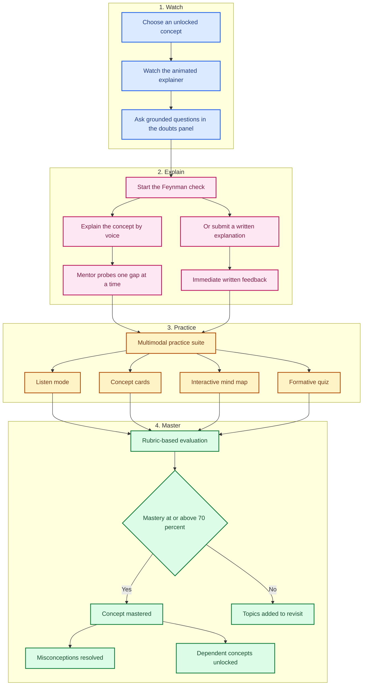
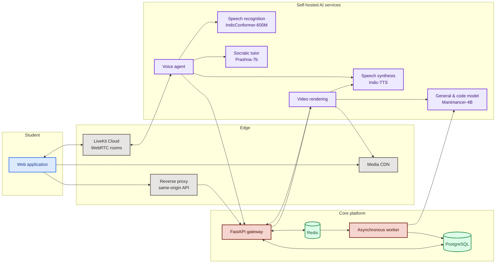
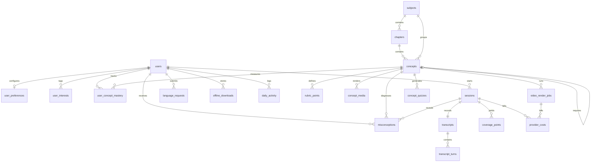
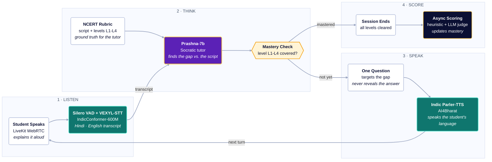

# Akara — Watch. Explain. Learn.

**An intelligent NCERT learning platform that turns passive video watching into active, spoken understanding.**

Akara helps students in Grades 6 through 12 master Science, Mathematics, Physics, Chemistry, and Biology by teaching concepts back in their own language. A student watches a concise animated explainer, explains the idea out loud to a Socratic AI mentor, practices through four multimodal formats, and unlocks the next concept only after demonstrating genuine mastery.

The first half of this document describes the product and the learner experience. The second half documents the engineering architecture, data model, pipelines, and operational design.

**Contents**

**Product:** [The Problem](#1-the-problem) · [What Akara Is](#2-what-akara-is) · [The Learning Loop](#3-the-akara-learning-loop) · [Student Journey](#4-a-students-journey) · [Product Experience](#5-the-product-experience) · [Curriculum](#6-curriculum-and-pedagogy) · [Language](#7-language-and-accessibility) · [Demo](#8-product-demonstration) · [Why Akara](#9-why-akara)

**Engineering:** [Overview](#10-technical-overview) · [High-Level Design](#11-high-level-design) · [Topology](#12-runtime-and-deployment-topology) · [Data](#13-data-architecture) · [Video](#14-video-generation-pipeline) · [Voice](#15-voice-and-feynman-pipeline) · [Assessment](#16-assessment-and-mastery) · [API](#17-api-and-contracts) · [Reliability](#18-reliability-caching-and-cost-control) · [Security](#19-security-and-privacy) · [Operations](#20-operations-and-observability) · [Repository](#21-repository-and-documentation) · [Tradeoffs](#22-design-tradeoffs-and-future-direction)

---

## At a Glance

| Dimension | Akara |
|---|---|
| Audience | NCERT students in Grades 6 through 12 |
| Curriculum scope | 239 chapters and more than 2,000 concepts across Science and Mathematics |
| Learning model | Watch, explain, practice, master |
| Languages | 14 Indian languages plus Indian English |
| Assessment | Four-level rubric with a 70 percent mastery gate |
| AI posture | 100% open-weight, self-hosted models ([Prashna-7b](https://huggingface.co/rachitgoyell/Prashna-7b), [Manimancer-4B](https://huggingface.co/rachitgoyell/Manimancer-4B), IndicConformer, Indic-TTS) |

---

# Part I — The Product

## 1. The Problem

Indian secondary education is built on a difficult contradiction. The curriculum is standardized, the examinations are high-stakes, and the number of students who need personal attention is enormous. A single teacher may guide more than a hundred students, with little time to diagnose why an individual learner is stuck.

Most digital learning products respond by making lectures easier to consume. They record a teacher, package the video, and add a progress bar. The student becomes a spectator. Watching a clear explanation can create a feeling of understanding, but it does not prove that the student can reconstruct the idea, recognize its boundaries, or apply it in a new situation.

Three gaps remain. Students rarely get a chance to explain a concept in their own words and receive a targeted response to the exact gap in their reasoning. Vernacular knowledge is often treated as a temporary scaffold rather than a legitimate learning medium. And conventional assessments produce a score without identifying the mental model that is wrong, the prerequisite that is missing, or what to revisit next.

Akara is designed around a different premise: understanding becomes visible when a student can teach the concept back. The product exists to make that moment frequent, measurable, and available in the language the student actually thinks in.

---

## 2. What Akara Is

Akara is a complete learning environment for NCERT Science and Mathematics. It combines procedural animated explainers, a real-time voice mentor, multimodal practice, diagnostic remediation, and a visual curriculum map.

The product is built around four commitments:

- **Active recall over passive review.** The student must produce an explanation, not merely recognize a correct option.
- **Language parity over translation.** The selected language drives narration, voice conversation, practice content, and interface copy.
- **Diagnosis over scoring.** A missed concept becomes a specific, actionable misconception rather than an anonymous percentage.
- **Mastery over completion.** Access to advanced topics is earned through demonstrated understanding, not time spent or videos watched.

Akara does not replace the teacher. It gives the student a patient, private, always-available practice partner that can listen, probe, and respond without judgment. It gives the teacher and the institution a clearer picture of where learning is actually breaking down.

---

## 3. The Akara Learning Loop

Every concept follows the same four-stage loop. It is short enough to fit into a study session and rigorous enough to produce evidence of understanding.

**Watch.** The student receives a short, mathematically precise explainer for the selected concept. A doubts panel answers questions using the canonical lesson script and the current concept boundaries. The goal is not to cover everything. The goal is to give the student enough structure to attempt an explanation.

**Explain.** The student taps the mentor and teaches the concept back. The mentor listens in the chosen language, compares the explanation against a four-level rubric, and asks one focused question at a time. If the student is confused, the mentor scaffolds down to a concrete everyday analogy before returning to the formal idea. A written path is available for students without a microphone or in quiet environments.

**Practice.** Practice is not a single quiz screen. It is a suite of four complementary modes: an audio review with captions, a deck of concept cards, a visual mind map, and a formative quiz with explanations for every option. Each mode reinforces a different representation of the same concept.

**Master.** The session is evaluated against the rubric. A score of 70 percent or higher marks the concept as mastered, resolves relevant misconception diagnostics, and unlocks dependent concepts. A lower score produces a diagnosis and routes the student to the specific topics that need another look.

---

## 4. A Student's Journey

The first session is intentionally simple. Akara asks for a class and a preferred language, then places the student directly inside a curriculum map that reflects what they can access today. From there, the student opens a chapter, watches a concept, teaches it back, practices, and unlocks the next node only after mastery.

The journey is designed to produce a finished learning artifact in every session: a watched explainer, a spoken or written explanation, a practice record, and a visible change in the constellation. The student should never leave a session wondering whether anything happened.

---

## 5. The Product Experience

The interface uses a warm, low-distraction visual language. Progress is expressed spatially through the constellation, conceptually through cards and maps, and numerically through the progress dashboard.

### 5.1 Landing and Account Creation

The landing page introduces the learning loop, the curriculum breadth, and the promise of explanation-based mastery. Account creation supports email and Google sign-in. A returning student is taken directly to the dashboard; a new student is guided into onboarding.

<!-- UI SCREENSHOT PLACEHOLDER START -->

*The landing page introduces Watch, Explain, Practice, and Master, with a direct path into account creation.*
<!-- UI SCREENSHOT PLACEHOLDER END -->

### 5.2 Onboarding

Onboarding is deliberately short. The student selects a class and a preferred language. The language choice determines the language of video narration, voice mentorship, practice content, and future generated media.

<!-- UI SCREENSHOT PLACEHOLDER START -->

*The onboarding flow spans Grades 6 through 12 and presents native language options with script previews.*
<!-- UI SCREENSHOT PLACEHOLDER END -->

### 5.3 Home and Curriculum

The home dashboard presents subjects as large, readable cards with chapter counts, concept counts, and current mastery. The student moves from subject to chapter to concept without losing context.

<!-- UI SCREENSHOT PLACEHOLDER START -->

*The dashboard shows the student's grade, available subjects, and per-subject progress.*
<!-- UI SCREENSHOT PLACEHOLDER END -->

### 5.4 Chapters and the Constellation

Chapters are presented in NCERT order. Each chapter card shows concept counts and progress. Opening a chapter reveals the constellation: a visual path of concept nodes connected by prerequisites.

Each node carries a clear state: locked, available, learning, mastered, or needs revisit. Selecting a node opens a focused action panel with Learn, Explain, Practice, and Mark as Mastered. Marking a concept as mastered updates the path and unlocks its dependents.

<!-- UI SCREENSHOT PLACEHOLDER START -->

*The constellation shows prerequisite dependencies, mastered nodes, available concepts, and the next recommended step.*
<!-- UI SCREENSHOT PLACEHOLDER END -->

### 5.5 Learn Mode

Learn mode is built around the explainer. Beneath the player, the doubts assistant answers questions using the lesson script and canonical concept content. The student can pause, ask, and continue without leaving the page. The player supports the selected language, synchronized captions, and a low-bandwidth mode.

<!-- UI SCREENSHOT PLACEHOLDER START -->

*Learn mode combines the animated explainer with a grounded doubts assistant and language-aware captions.*
<!-- UI SCREENSHOT PLACEHOLDER END -->

### 5.6 Explain Mode

Explain mode is the emotional center of the product. The interface becomes quieter. The student sees a responsive mentor visualizer that listens while they speak and responds with a single, focused question.

The mentor does not lecture and does not reveal answers. It listens for the student's current mental model, identifies the largest gap, and asks a question that helps the student notice the gap themselves. If the student is silent or says they do not know, the mentor moves to a concrete example rather than repeating the same question. A written explanation path provides the same rubric-based evaluation without requiring audio.

<!-- UI SCREENSHOT PLACEHOLDER START -->

*Explain mode presents a reactive mentor visualizer, live vernacular transcription, and a single Socratic question at a time.*
<!-- UI SCREENSHOT PLACEHOLDER END -->

### 5.7 The Practice Suite

Practice remains available after an explanation. The four modes reinforce the same concept through different channels.

**Listen mode.** An audio-first review with captions and scrubbing, useful for auditory learners and for revisiting a concept while commuting.

**Concept cards.** A deck of definitions, formulas, units, and core principles derived from the concept, supporting quick recall and spaced review.

**Mind map.** A visual graph of the concept's entities, properties, and relationships, generated from the same scene graph used by the explainer.

**Formative quiz.** Eight to ten conceptual questions with detailed rationales, designed to test application and edge cases rather than recall of isolated phrases.

<!-- UI SCREENSHOT PLACEHOLDER START -->

*The practice suite combines Listen, Concept Cards, Mind Map, and a formative Quiz.*
<!-- UI SCREENSHOT PLACEHOLDER END -->

### 5.8 Progress and Diagnostics

The progress dashboard turns learning activity into a readable picture of growth. It shows concepts mastered, concepts to revisit, active days, subject-level mastery, and a weekly habit calendar.

The diagnostic board records what the student believed, not only that an answer was wrong. A misconception such as “action and reaction forces cancel each other” becomes a specific diagnostic with an actionable hint. It remains visible until the student demonstrates mastery of the underlying idea.

<!-- UI SCREENSHOT PLACEHOLDER START -->

*The progress surface combines mastery, weekly activity, and specific misconception diagnostics.*
<!-- UI SCREENSHOT PLACEHOLDER END -->

### 5.9 Profile, Library, and Language Requests

The profile page consolidates identity, class, language, interests, accessibility preferences, and offline downloads. The library provides a searchable view of the full catalog with language coverage. Students can request a language that is not yet available; demand is aggregated and used to prioritize future content production.

<!-- UI SCREENSHOT PLACEHOLDER START -->

*Profile and library surfaces connect preferences, offline access, and community language demand.*
<!-- UI SCREENSHOT PLACEHOLDER END -->

---

## 6. Curriculum and Pedagogy

Akara follows the NCERT scope for Grades 6 through 12. The curriculum is organized into subjects, chapters, and concepts. Concepts are the atomic learning unit, and each concept has a prerequisite relationship to the concepts that must be mastered before it.

| Grade band | Subjects | Learning emphasis | Prerequisite structure |
|---|---|---|---|
| Grades 6 through 8 | Science and Mathematics | Foundations, observation, vocabulary, number sense | Short linear chains with cross-chapter bridges |
| Grades 9 and 10 | Science and Mathematics | Integrated scientific reasoning and formal methods | Branched domains with formula and concept dependencies |
| Grades 11 and 12 | Physics, Chemistry, Biology, Mathematics | Specialized disciplinary models and applications | Deep acyclic graphs with multi-chapter prerequisites |

The catalog contains 239 chapters and more than 2,000 concepts. The prerequisite graph is not decorative. It prevents a student from entering a concept without the mental models required to understand it.

### The Four-Level Feynman Rubric

Every concept is anchored by a rubric that defines what a complete explanation must contain. The rubric is the shared source of truth for the voice mentor, the written evaluation, and the post-session scoring engine.

| Level | Cognitive demand | What the student must demonstrate |
|---|---|---|
| Level 1 | Factual recall and nomenclature | Correct terminology, definitions, quantities, and units |
| Level 2 | Relational understanding | Cause and effect, governing laws, equations, and mechanisms |
| Level 3 | Boundary conditions and misconceptions | Differentiation between the correct model and the common intuitive error |
| Level 4 | Contextual synthesis | A new, original example that applies the concept under unfamiliar conditions |

### Mastery

A concept is mastered when the student's evaluated explanation reaches 70 percent. Mastery is based on weighted rubric coverage, not on the number of attempts or the length of the session. A misconceived rubric point receives no credit and produces a diagnostic. A strong application-level example carries additional weight.

The gate has three consequences: the concept moves to the mastered state, dependent concepts become available, and open misconception diagnostics for that concept are resolved. The student can continue to practice, but the system no longer treats the concept as unfinished.

---

## 7. Language and Accessibility

Language is a first-class part of the pedagogy, not a localization layer added after the product is built. A student who thinks in Hindi, Marathi, Bengali, or Hinglish should be able to learn and be assessed in that language.

Akara supports 14 Indian languages plus Indian English. The language selected during onboarding governs video narration, speech recognition, mentor speech, doubts answers, concept cards, summaries, quiz content, and the language recorded in the learning transcript.

The system handles code-switching. A student may begin in Hindi, introduce an English technical term, and continue in Hindi. The mentor follows the student's language rather than forcing a monolingual conversation.

Accessibility and low-connectivity support are also core requirements:

- Data Saver mode reduces animation and media bandwidth.
- Audio-first review supports low-vision and auditory learners.
- Captions accompany spoken content.
- Chapter downloads support study without a live connection.
- The interface is responsive on budget Android devices.
- The written explanation path supports students without functional microphones.

---

## 8. Product Demonstration

The demonstration video walks through the complete learner journey: onboarding in Hindi, navigating a Grade 10 Science chapter, watching an explainer, completing a live Feynman voice session, reviewing the diagnostic, and unlocking the next concept.

<!-- DEMO VIDEO PLACEHOLDER START -->
**[DEMO VIDEO: Akara — Watch. Explain. Learn.]**

Title: Akara Product Walkthrough and Socratic Voice Session

Duration: 03:45 · Format: 1080p, 60 fps, MP4

Poster: /docs/assets/video/demo-poster.png

Source: /docs/assets/video/akara-product-demo.mp4

Narration: product problem, learning loop, video generation, voice mentorship, mastery evidence, and progress remediation.
<!-- DEMO VIDEO PLACEHOLDER END -->

Recommended narration beats:

1. **The problem.** Students watch more but explain less. The gap is invisible until they try to teach the idea.
2. **The learning loop.** Watch, explain, practice, and master, all inside one concept.
3. **One explainer for every student.** The first learner triggers generation; every later learner receives the same asset instantly.
4. **The voice mentor.** A student explains in Hindi while the mentor probes one conceptual gap at a time.
5. **Proof of learning.** Coverage evidence becomes a mastery score, a diagnostic, and a newly unlocked concept.
6. **The system underneath.** One self-hosted stack for content, voice, assessment, and progress.

---

## 9. Why Akara

**It measures explanation, not exposure.** Completion rates and watch time are weak proxies for understanding. Akara asks the student to produce an explanation and evaluates it against a concept-specific rubric.

**It treats language as part of understanding.** A student who understands a concept but cannot express it in English is not failing science. Akara lets the explanation, mentorship, and practice happen in the language the student uses most naturally.

**It turns misconceptions into a plan.** Most products report that an answer was wrong. Akara records the belief behind the answer and turns it into a targeted remediation task.

**It unlocks knowledge instead of counting time.** Prerequisites are enforced because conceptual dependencies are real. The constellation makes that structure visible and gives the student a meaningful sense of progression.

**It is private and built for the real classroom.** Student speech, explanations, and learning evidence stay private. The product assumes noisy audio, shared devices, intermittent connectivity, and limited bandwidth.

---

# Part II — Engineering

## 10. Technical Overview

Akara is a monorepo containing a web application, an API gateway, asynchronous workers, a video rendering service, a real-time voice agent, speech recognition and synthesis services, shared database packages, and offline retrieval utilities.

The engineering design is organized around four principles.

**Separation by operational profile.** The voice loop is latency-critical and conversational. Video rendering is compute-intensive and batch-oriented. They are isolated so a render spike cannot degrade a live tutoring session.

**One canonical join key.** Every subsystem agrees on a single concept identifier. It connects curriculum records, generated media, voice sessions, rubric points, retrieval, and progress.

**Open-weight AI throughout.** Speech recognition, speech synthesis, the Socratic tutor, the general content model, and the scoring model are self-hosted. No closed-source inference provider sits in the hot path.

**Generation happens once, serving everyone.** Media and practice content are generated per concept and language, then shared across all students. Distributed locks, job identifiers, and retry budgets prevent duplicate work.

The system runs as a single Docker Compose deployment on a modest VPS, with an optional GPU profile for faster rendering and voice inference.

### Open-Source AI Stack

Zero proprietary cloud AI APIs. All speech, language, and evaluation components run self-hosted with open weights:

| Component | Model | Architecture / License | Role in Akara |
|---|---|---|---|
| **Socratic Tutor** | [`rachitgoyell/Prashna-7b`](https://huggingface.co/rachitgoyell/Prashna-7b) | Qwen2.5-7B-Instruct (Apache-2.0) · GRPO fine-tuned | Real-time Socratic voice tutor; probes understanding gaps turn-by-turn; `<think>` reasoning stripped before TTS |
| **General & Media LLM** | [`rachitgoyell/Manimancer-4B`](https://huggingface.co/rachitgoyell/Manimancer-4B) | Qwen3-4B (Apache-2.0) · STEM & Manim SFT | Scene planning, Manim codegen + auto-fix loop, quiz generation, and Tier 2 entailment scoring |
| **Speech Recognition (STT)** | AI4Bharat IndicConformer-600M | Conformer 600M (MIT) · 16 kHz mono | Low-latency streaming Indic speech-to-text via self-hosted VEXYL-STT WebSocket server |
| **Speech Synthesis (TTS)** | AI4Bharat Indic-TTS (`indic-parler-tts`) | Parler-TTS transformer (Apache-2.0) | High-quality vernacular narration and mentor voice across 13 Indic languages + Indian English |
| **Voice Activity Detection** | Silero VAD | Open-weight (MIT) | Real-time speech detection, 800 ms silence endpointing, and natural student barge-in |
| **Textbook Grounding (RAG)** | `multilingual-e5` + FAISS | Dense vector index | Offline NCERT textbook passage retrieval to ground scene plans and canonical scripts |

---

## 11. High-Level Design

Students interact with a web application. The application talks to a single API through a same-origin reverse proxy. The API owns identity, curriculum, progress, media status, and token minting. Background workers own asynchronous scoring and content generation. Dedicated services own video rendering, speech recognition, speech synthesis, and the real-time voice agent.

### Service Responsibilities

| Service | Primary responsibility | Scaling profile |
|---|---|---|
| Web | Serves the single-page application and proxies same-origin API traffic | Stateless, horizontally scalable |
| API | Authentication, curriculum, library, media status, progress, tokens, webhooks | Stateless, horizontally scalable |
| Worker | Post-session scoring, quiz generation, scene graph, summaries | Queue-driven, horizontally scalable |
| Video | Five-stage explainer generation and publication | CPU and storage intensive, bounded concurrency |
| Voice | Real-time WebRTC session, Socratic dialogue, transcript capture | One worker process per active session |
| Speech services | Streaming Indic speech-to-text and vernacular speech synthesis | GPU preferred, CPU supported |
| Language models | Content, scene planning, scoring ([Manimancer-4B](https://huggingface.co/rachitgoyell/Manimancer-4B)), Socratic probing ([Prashna-7b](https://huggingface.co/rachitgoyell/Prashna-7b)) | Shared inference endpoints |
| Data services | Durable system of record, cache, distributed locks, render slots, job queue, rate limits | Vertical scaling and backups |

---

## 12. Runtime and Deployment Topology

The default deployment is a single-host Compose stack. A reverse proxy serves the web application and forwards API traffic. PostgreSQL and Redis remain on the private network. The video, speech, and model services communicate over the internal container network. Only the reverse proxy is exposed publicly in production.

Production posture:

- The reverse proxy is the only public entry point.
- Database, cache, render, speech, and model ports are not published publicly.
- TLS is terminated in front of the proxy.
- The object store serves media through a CDN.
- The voice agent connects outbound to LiveKit Cloud and the internal speech services.
- Secrets are provided through the environment and are never committed.
- Model weights and speech models are cached in persistent volumes.
- The API applies migrations before serving traffic and seeds the catalog on an empty database.

The minimum production sizing target is four virtual CPUs, eight gigabytes of RAM, and sixty gigabytes of disk. A GPU is optional but improves speech and model latency. Video rendering is bounded to prevent a single host from being overwhelmed.

---

## 13. Data Architecture

PostgreSQL is the system of record. The schema contains twenty tables organized into six domains: identity, curriculum, media generation, learning evidence, progress and diagnostics, and platform accounting.

| Domain | Tables | Purpose |
|---|---|---|
| Identity | users, user_preferences, user_interests | Account identity, onboarding, preferences, personalization |
| Curriculum | subjects, chapters, concepts, rubric_points | NCERT catalog, prerequisite graph, gold scripts, rubric ladder |
| Media generation | concept_media, video_render_jobs, concept_quizzes | Per-language media state, render history, practice bundle |
| Learning evidence | sessions, transcripts, transcript_turns, coverage_points | Attempts, immutable transcripts, turns, rubric evidence |
| Progress | user_concept_mastery, misconceptions | Concept state, best mastery, active diagnostics |
| Platform | language_requests, offline_downloads, daily_activity, provider_costs | Language demand, offline catalog, habits, cost ledger |

### Core Tables

**users, preferences, and interests.** Store identity, password hash, Google identity, profile photo, class, default language, onboarding state, Data Saver mode, and free-form interest tags.

**subjects, chapters, concepts, and rubric_points.** Represent the curriculum hierarchy, prerequisite identifier, canonical script, and the relational projection of the rubric used by the scorer.

**concept_media, video_render_jobs, and concept_quizzes.** Track per-language media state, render history and stage timings, and the generated practice bundle. Generation status is the deduplication marker.

**sessions, transcripts, and transcript_turns.** Record voice and written attempts, immutable transcript payloads, normalized speaker turns, detected language, and confidence.

**coverage_points.** The academic audit trail: one verdict per rubric point per session, paired with the student's exact evidence quote.

**user_concept_mastery and misconceptions.** Track concept status, attempt count, best mastery score, and actionable diagnostic records that move from needs review to resolved.

### Lifecycle Rules

Media moves through pending, processing, complete, and failed states. A failed render may be retried within a bounded budget, after which it becomes terminal. Quiz generation moves through generating, ready, and failed states. Concept progress moves through locked, available, learning, mastered, and needs revisit.

---

## 14. Video Generation Pipeline

The video service converts a canonical concept script into an animated explainer. Each concept and language pair is rendered once, published to object storage, and served to every student from the CDN.

```mermaid
flowchart LR
  subgraph S1["1 · GROUND"]
    A("<b>NCERT Chapter</b><br/>topic · grade · language") --> B("<b>RAG Retrieval</b><br/>multilingual-e5 + FAISS<br/><i>exact textbook passage</i>")
  end
  subgraph S2["2 · VISUALS"]
    C("<b>Scene Planner</b><br/>Manimancer-4B<br/><i>topic to scene-by-scene plan</i>") --> D("<b>Manim Code + Render</b><br/>Manimancer-4B<br/><i>writes, renders, auto-fixes</i>")
  end
  subgraph S3["3 · VOICE"]
    E("<b>Script Writer</b><br/>Manimancer-4B<br/><i>narration timed to scenes</i>") --> F("<b>Indic Parler-TTS</b><br/>AI4Bharat<br/><i>voice for every scene</i>")
  end
  subgraph S4["4 · PUBLISH"]
    H("<b>ffmpeg Stitch</b><br/>mux + concatenate<br/><i>audio synced to video</i>") --> I("<b>Final MP4</b><br/>R2 storage + CDN<br/><i>instant replay for students</i>")
  end
  B --> C
  D --> E
  D -- "scene MP4s" --> H
  F --> H

  classDef llm fill:#5B21B6,stroke:#F5C451,stroke-width:2.5px,color:#ffffff
  classDef oss fill:#0F766E,stroke:#5EEAD4,stroke-width:2px,color:#ffffff
  classDef step fill:#ffffff,stroke:#B8C2DD,stroke-width:2px,color:#0B1033
  classDef done fill:#0B1033,stroke:#F5C451,stroke-width:2px,color:#ffffff
  linkStyle default stroke:#9AA5C0,stroke-width:2px
  style S1 fill:#F8FAFF,stroke:#DDE3F3,stroke-width:1.5px,color:#475569
  style S2 fill:#F8FAFF,stroke:#DDE3F3,stroke-width:1.5px,color:#475569
  style S3 fill:#F8FAFF,stroke:#DDE3F3,stroke-width:1.5px,color:#475569
  style S4 fill:#F8FAFF,stroke:#DDE3F3,stroke-width:1.5px,color:#475569
  class A,H step
  class B,F oss
  class C,D,E llm
  class I done
```

The rendering engine decomposes video production into five stages:

1. **Scene planning.** The canonical script and retrieved NCERT textbook context (`multilingual-e5`) are processed by [**Manimancer-4B**](https://huggingface.co/rachitgoyell/Manimancer-4B) to produce a structured scene plan (`outputs/scenes.json`), specifying visual objects, mathematical elements, color emphasis, and timestamps per scene.
2. **Animation codegen and render.** Manimancer-4B generates modular Manim Python classes for each scene. An **Indic-in-Tex Sanitizer** pre-emptively intercepts any `MathTex(...)` or `Tex(...)` calls containing non-Latin Unicode (Devanagari, Tamil, etc.) and rewrites them into Pango `Text(...)` elements to prevent LaTeX compilation failures. Scenes are rendered headlessly via Manim CE. If compilation fails, traceback errors return to Manimancer-4B in an automated repair loop (up to 3 retries).
3. **Script alignment.** Narration is aligned against rendered scene durations (`sections.json`) by Manimancer-4B to ensure speech fits the visual pacing without hallucinating new concepts.
4. **Vernacular speech synthesis.** Per-scene narration is synthesized across 13 Indic languages and Indian English using **AI4Bharat Indic-TTS** (`indic-parler-tts`) into 16 kHz mono WAV audio.
5. **Assembly and publication.** Audio and video streams are muxed via `ffmpeg` (`-c:v copy -shortest`), concatenated, and published to Cloudflare R2 object storage. A webhook callback updates `generation_status` to `complete`, unlocking instant replay from CDN and enqueuing practice bundle generation.

### Media Generation Lifecycle

The generation-status endpoint is the most frequently polled surface in the product. It must be fast, idempotent, and safe under concurrent demand. The behavior protects compute. A completed video is served immediately and permanently. A second student arriving during a render attaches to the in-flight job. A distributed lock prevents duplicate renders for the same concept and language. A global render-slot limit queues excess demand. A stale job with no progress is swept and replaced once. A terminal failure exhausts the retry budget and stops further automatic rendering.

---

## 15. Voice and Feynman Pipeline

The voice loop is a real-time conversation between the student and a Socratic mentor. It runs over WebRTC, with speech recognition, reasoning, and speech synthesis connected in a tight loop. The hot path deliberately excludes vector retrieval and heavy assessment. The concept is resolved before the room starts, and deep scoring happens after the room ends.

The voice agent maintains conversational state and walks the rubric from Level 1 through Level 4, asking one question per turn. It does not reveal answers. When a student is stuck, it scaffolds down to a concrete physical situation, then guides the student back to the formal explanation.

**Transport and turn-taking.** LiveKit provides the real-time audio room. The browser sends the student's microphone track and receives the mentor's audio track. Local **Silero VAD** (configured with 800 ms silence duration and 0.5/0.3 confidence thresholds) accurately endpoints student utterances and enables natural barge-in interruptions.

**Speech recognition.** The self-hosted **VEXYL-STT** WebSocket server wraps AI4Bharat **IndicConformer-600M** (Conformer encoder + CTC/RNN-T decoder), streaming low-latency transcripts across Hindi, English, and code-switched Hinglish.

**Socratic reasoning with [`rachitgoyell/Prashna-7b`](https://huggingface.co/rachitgoyell/Prashna-7b).** Prashna-7b is a Qwen2.5-7B-Instruct fine-tune trained with GRPO on synthetic Socratic tutoring dialogues to probe gaps rather than provide answers. It plans its pedagogical strategy using internal `<think>...</think>` reasoning blocks; the runtime automatically strips `<think>` tags before passing text to TTS so internal reasoning is never voiced. The agent strictly enforces leveled rubric gating (L1 Recall → L2 Conceptual → L3 Boundary/Misconceptions → L4 Contextual application), probing only the active incomplete tier and advancing only when its mastery threshold is satisfied.

**Synthesis and capture.** **AI4Bharat Indic-TTS** (`indic-parler-tts`) synthesizes natural, animated mentor speech in the student's chosen language. When the session ends, the agent dumps the immutable transcript with per-turn latency logs (`stt_lat_ms`, `llm_ttft_ms`, `tts_ttfb_ms`) to the API through a signed webhook to trigger deep scoring.

### Text Explanation Path

The written path shares the same assessment core. The student submits an explanation, the API performs a fast heuristic evaluation for immediate feedback, writes provisional evidence, and enqueues an asynchronous refinement job. The refined coverage wins when it completes. This gives the student a responsive interface without compromising the auditable final score.

### Latency Budget

The voice experience targets a conversational turn latency of approximately 1.2 seconds at the median on suitable infrastructure. The budget is split across endpointing, recognition, first-token generation, first-audio synthesis, and transport.

| Segment | Typical target | Mitigation |
|---|---|---|
| Voice activity and endpointing | 250 to 400 ms | Local detection with tuned silence thresholds |
| Speech recognition | 350 to 600 ms | Streaming decoding on the internal network |
| Tutor first token | 300 to 550 ms | Continuous batching and cached inference |
| Speech synthesis first chunk | 250 to 450 ms | Chunked synthesis into the audio track |
| End-to-end turn | 1.2 to 2.1 seconds | Transport, streaming, and regional edge presence |

The numbers are targets, not guarantees. CPU-only deployments are slower and remain functional. The architecture degrades in latency rather than correctness.

---

## 16. Assessment and Mastery

Akara separates live conversation from rigorous evaluation. The voice mentor needs to respond quickly; the scoring engine needs to be careful, auditable, and reproducible. Combining both into a single synchronous model call would make the conversation slow and the score less trustworthy.

### Two-Tier Scoring

The synchronous path normalizes the explanation, removes common stopwords in English and Hindi, applies lightweight stemming, and compares the result against the key terms in the rubric. It returns a provisional score and headline feedback immediately. Its purpose is to keep the interface responsive, not to make the final academic judgment.

The asynchronous path operates on the complete transcript or written explanation. It splits the text into sentences, embeds them, and compares them against each rubric point. Candidate pairs are evaluated by an entailment judge powered by [**Manimancer-4B**](https://huggingface.co/rachitgoyell/Manimancer-4B) (`services/scorer/llm_scorer.py`), which determines whether the student's statement genuinely demonstrates understanding of the rubric requirement or merely repeats keywords.

Every rubric point receives one of three verdicts: **covered**, where the explanation entails the requirement; **missed**, where it does not address the requirement; or **misconceived**, where it asserts a contradictory or incorrect mental model. The verdict is stored with the student's exact quote. This makes the score auditable by a teacher or reviewer and makes the diagnostic meaningful to the student.

### Mastery Calculation

Mastery is a weighted measure of rubric coverage. Covered points contribute their full weight. Missed points contribute nothing. Misconceived points contribute nothing and create a diagnostic. The application-level rubric point carries additional weight because it demonstrates transfer rather than recall.

A concept is mastered when the weighted result reaches 70 percent. The score is stored as the student's best mastery for that concept. Mastery is monotonic: a later weaker attempt does not remove a previously earned mastery state.

### Diagnostics

Diagnostics are first-class learning objects, not error logs. Each diagnostic contains the concept and rubric point, the student's evidence quote, a severity level, a plain-language insight, an actionable hint, and a status that moves from needs review to resolved. A diagnostic is resolved when the student demonstrates mastery of the concept, not by simply viewing it.

---

## 17. API and Contracts

The API is a FastAPI application organized by domain. Every route is authenticated except signup, login, Google authentication, public library summaries, and health checks.

| Group | Responsibility |
|---|---|
| Authentication | Signup, login, Google identity, account linking |
| Users | Profile, preferences, interests, photo, offline chapters |
| Curriculum | Subjects, chapters, concept detail, prerequisite state |
| Library | Catalog summary, search, hierarchy, language coverage |
| Concepts | Generation status, media bundle, doubts chat |
| Explanations | Written evaluation, mastery submission |
| Progress | Summary, learning map, mastery overlays |
| Diagnostics | Misconception list and resolution |
| Activity | Daily heartbeat and habit calendar |
| Languages | Demand board and language requests |
| Internal | Render callbacks and LiveKit token minting |
| Webhooks | Signed transcript intake |

### Language Resolution

Language resolution follows a single rule everywhere: an explicit language parameter wins, otherwise the student's profile default is used, otherwise Hindi is the final fallback. The same rule applies to video rendering, media bundles, practice generation, doubts chat, and the voice session.

### Core Contracts

**Concept metadata.** Carries the concept identifier, title, canonical script, rubric, grade, subject, and language. It is passed to the voice agent as room metadata and used by the video pipeline as the narration source.

**Session transcript.** Carries the room name, concept identifier, student identifier, language, ordered speaker turns, speech confidence, and latency measurements. It is immutable once recorded.

**Coverage result.** Carries the concept, student, mastery score, per-rubric verdicts, evidence quotes, scorer version, and timestamp. It is the contract between scoring and progress.

**Practice bundle.** Carries the video reference, transcript summary, key definitions, scene graph, quiz items, and mentor prompt. The client can render all four practice modes from one response.

---

## 18. Reliability, Caching, and Cost Control

The system performs expensive operations: video rendering, speech inference, language model generation, and transcript evaluation. Reliability is therefore inseparable from cost control. Akara treats redundant work as a correctness problem, not only a budget problem.

| Redis key family | Purpose | Lifetime |
|---|---|---|
| Generation status cache | Absorbs high-frequency polling during renders | Seconds |
| Media language cache | Lists completed languages for a concept | Minutes |
| Library cache | Summaries, search results, hierarchy | Minutes |
| Mastery cache | Per-student constellation overlay | Short |
| Render lock | Prevents duplicate renders for a concept and language | Render duration |
| Render slots | Caps concurrent video generation | Atomic counter |
| Job queue | Scoring and practice generation | Until completion |
| Rate limits | Protects authentication and generation endpoints | Sliding window |

A concept and language pair has exactly one media record. If fifty students open the same unrendered concept at once, the first request acquires the lock and starts the render. The others attach to the in-flight job and poll the same status. When the render completes, the media record is shared by every student.

The practice bundle follows the same pattern. It is generated once per concept and language, marked as generating, and reused after completion. A missing bundle self-heals by enqueueing generation on the first media request.

Automatic retries are bounded. A render failure increments a retry counter. If the budget remains, a later request may trigger another attempt. If the budget is exhausted, the media is marked failed and no further automatic renders occur. A stale job with no progress is swept and replaced once. Recovery jobs use fresh identifiers so a crashed run can be retried rather than mistaken for an active duplicate.

Video rendering cannot take down the voice loop. Voice inference cannot block authentication. Practice generation cannot block media playback. The service and queue boundaries ensure that a failure in one expensive subsystem degrades a feature rather than the whole product.

---

## 19. Security and Privacy

Student learning data is sensitive. Akara limits collection, keeps audio ephemeral, and secures service-to-service communication.

- **Stateless authentication.** Users receive signed JSON Web Tokens with bounded lifetimes. Passwords are stored as salted hashes.
- **Google identity verification.** Credentials are verified against Google's public keys and the configured client audience. Existing email accounts can be linked to a Google identity.
- **Signed internal callbacks.** Transcript webhooks and render callbacks require a shared secret. Forged callbacks are rejected.
- **Rate limiting.** Authentication, token minting, and generation endpoints are protected by sliding-window limits.
- **Ephemeral audio.** Student audio is processed in memory for transcription. Raw audio is not stored as a permanent learning record.
- **Minimal transcript retention.** The transcript is stored for assessment and audit, with the student's text retained as evidence rather than the full audio stream.
- **Private media access.** Profile photos and generated media are stored in object storage and served through controlled public URLs.
- **Secret separation.** Runtime secrets are provided through the environment and excluded from version control.
- **Production fail-fast.** The application refuses to start in production with missing or weak authentication and webhook secrets.
- **No closed-source AI providers.** Speech, language, and scoring models run inside the deployment boundary.

---

## 20. Operations and Observability

The platform exposes health checks for every critical service. Orchestration uses them to decide when a service is ready to receive traffic.

| Surface | What it confirms |
|---|---|
| API health | Database connectivity, cache connectivity, and migration readiness |
| Proxy health | Ingress routing to the application |
| Speech recognition health | Model loaded and ready to accept streams |
| Speech synthesis health | Synthesis pipeline initialized |
| Video service health | Animation runtime, media tools, and rendering dependencies available |
| Web health | Static application is being served |
| Voice worker | Registered with the real-time transport |

Operational expectations:

- The database is backed up on a schedule and restored in staging before relying on a backup.
- Object storage retains the rendered media required to reconstruct the library.
- Model weights are cached in persistent volumes and survive container rebuilds.
- The API applies schema migrations before accepting traffic.
- The catalog seeds only when the database is empty, using an advisory lock to avoid duplicate seeding.
- Logs are rotated so a long-running host does not exhaust disk space.
- Render concurrency is capped to keep CPU and memory within the host budget.
- A GPU can be enabled for speech and model services without changing the application contract.

The most common operational issues are missing migrations, stale proxy resolution after an API rebuild, a speech service that is still loading, a callback secret mismatch, a render worker lost mid-job, and a voice session with no audio because the agent or transport is unavailable. Each has a deterministic check: migration state, upstream health, model readiness, shared secret, stale-job sweep, and agent registration.

---

## 21. Repository and Documentation

The monorepo is organized by deployment and ownership boundary.

| Path | Responsibility |
|---|---|
| apps/web | Student web application and same-origin API integration |
| services/api | Authentication, curriculum, library, media, progress, tokens, webhooks |
| services/worker | Asynchronous scoring and practice generation |
| services/scorer | Scoring logic and heuristic fallback |
| services/voice | Real-time LiveKit voice agent |
| services/video | Five-stage explainer generation pipeline |
| services/stt | Self-hosted Indic speech recognition |
| services/tts | Self-hosted Indic speech synthesis |
| packages/akara_db | SQLAlchemy models, enums, and syllabus catalog |
| packages/akara_common | Shared data contracts and schema definitions |
| packages/akara_rag | Offline retrieval and gold-topic resolution |
| scripts, alembic, tests | Catalog seeding, migrations, and contract, API, scorer, and pipeline tests |
| docs | Product, architecture, pipeline, operations, and system-design documentation |

### Documentation Index

The `docs/system-design/` directory contains the visual high-level and low-level design, the full database map, the video and Feynman pipelines, and the authentication and practice flows. The `docs/architecture/` directory covers monorepo rationale and data contracts. The `docs/pipelines/` directory covers scoring, the voice loop, multilingual behavior, speech recognition, retrieval, and video generation. The `docs/operations/` and `docs/getting-started/` directories cover secrets, local setup, production deployment, and troubleshooting.

---

## 22. Design Tradeoffs and Future Direction

Akara makes several deliberate tradeoffs.

| Decision | Benefit | Cost |
|---|---|---|
| One render per concept and language | Zero duplicate generation cost for every later student | The first student waits for generation |
| Voice hot path excludes retrieval and deep scoring | Low conversational latency and stable turn-taking | Assessment is asynchronous |
| Local voice activity detection | Natural barge-in and no closed-source routing | Requires tuning for noisy classrooms |
| Open-weight self-hosted models | Privacy, cost control, and deployment independence | Operationally heavier than managed APIs |
| Language-specific generated media | Natural narration and correct script rendering | Storage and generation cost scale with languages |
| Prerequisite-gated constellation | Pedagogically correct sequencing | A weak prerequisite can block a motivated student |

The next areas of investment are additional regional language coverage, teacher-facing analytics, adaptive review scheduling, offline media packaging, and evaluation tooling for rubric quality. The core loop remains stable: watch, explain, practice, and master, with evidence at every step.

---

## Closing

Akara treats explanation as the unit of learning. The product is designed for students who need more than another video library: they need a patient listener, a precise diagnosis, and a clear next step in their own language.

The engineering exists to make that experience reliable at scale. One canonical concept identifier connects the curriculum, the explainer, the mentor, the evidence, and the progress map. Expensive generation happens once and is shared. Live conversation stays fast. Assessment stays auditable. The result is a learning platform that measures what a student can explain, not merely what a student has watched.

*Akara — Watch. Explain. Learn.*
